 

 

### Neural Profile

`BUILDING` • `LEARNING` • `EVOLVING`

 

<table>
<tr>
<td width="50%" align="center" valign="top">

</td>
<td width="50%" align="center" valign="top">

</td>
</tr>
</table>

 

### Tech Stack

`FRONTEND` &nbsp;•&nbsp; `BACKEND` &nbsp;•&nbsp; `DATA` &nbsp;•&nbsp; `TOOLS`

  

 

 

 

### Currently Exploring

 

`$ status: always building and shipping` &nbsp;•&nbsp; built with ☕ and curiosity

